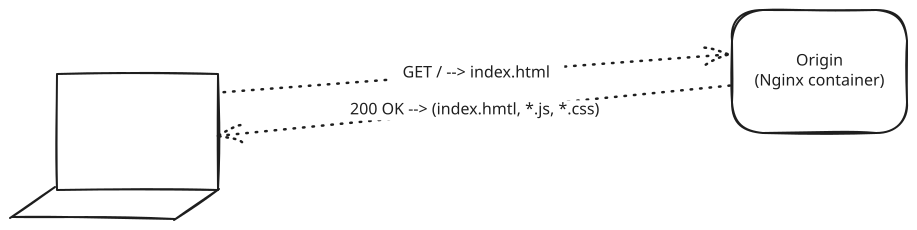
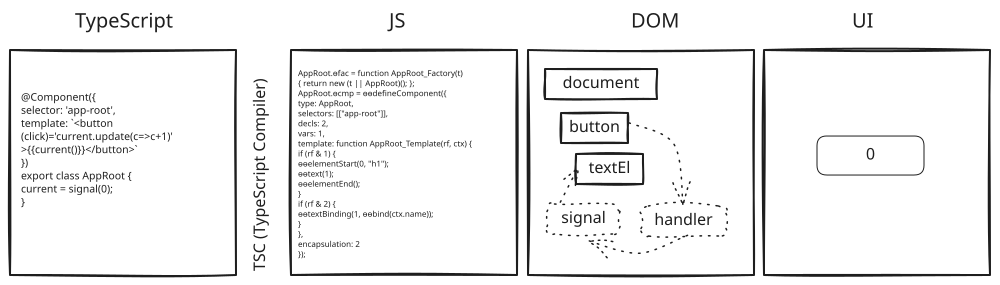

# Day 1 - Let's get our stack reset

## Development vs. production

In development we need:
- An IDE - VSCode or whatever.
- NodeJs Node Package Manager (NPM) Angular CLI (`ng`) is useful for creating a new angular app.
    - A Compiler - TypeScript (not quite 7 yet)
    - The Angular framework and associated libraries
    - A way to serve our application so we can see it
        - Vite (pronounced "Veet") - very common (React, Vue, Angular, etc.)
    - A way to build our application so we can "ship it"

## How an Angular gets delivered to a browser

The initial request returns `index.html`. That file has links to the assets (JavaScript files, CSS, images, etc.) that are needed to "bootstrap" the application.

`main.js` needs to be downloaded and executed for the application to create the DOM and be displayed and "interactive" (able to be interacted with by the user).

## Angular runtime and components

## Component communication

